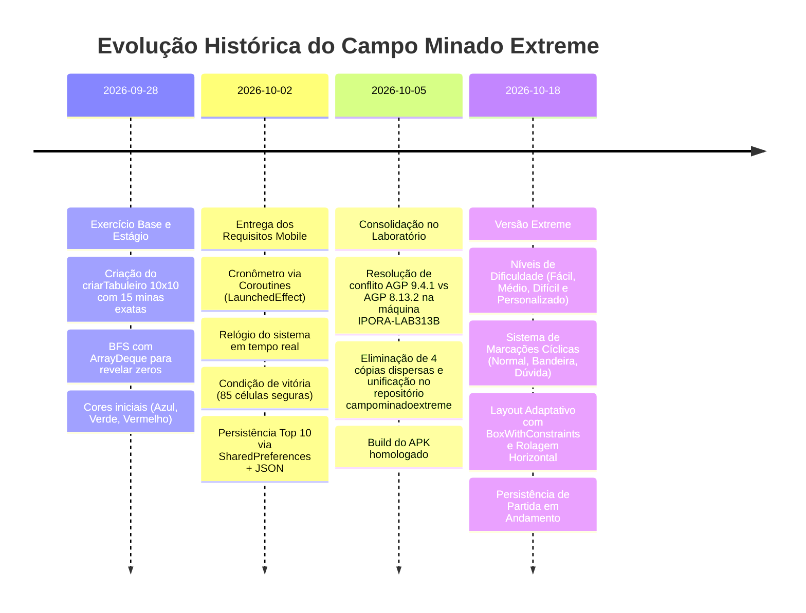
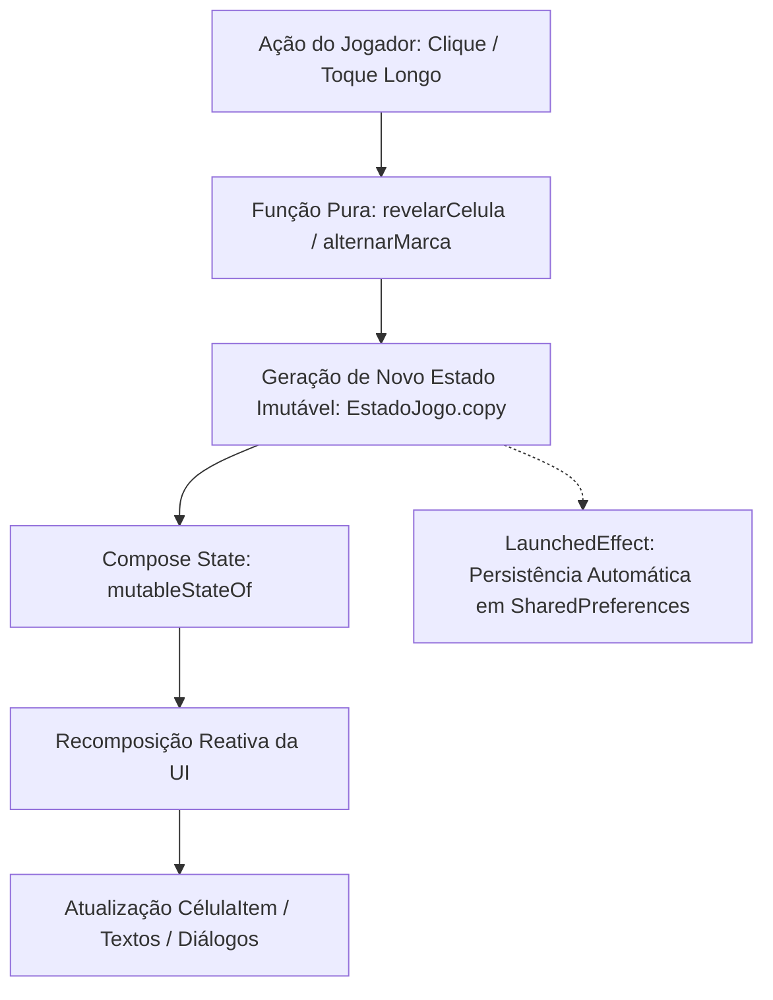

# Dossiê de Estudo e Fonte de Conhecimento: Campo Minado Extreme (Android / Jetpack Compose)

> **Documento Fonte para Google Gemini NotebookLM**  
> **Finalidade:** Servir como base de conhecimento integral para geração de resumos, audio overview (podcasts com duas vozes), flashcards, roteiros de apresentação acadêmica e sabatinas técnicas.  
> **Autor / Aluno:** Wésio de Araujo Filho  
> **Instituição:** Instituto Federal Goiano (IF Goiano) — Campus Iporá  
> **Curso:** Bacharelado em Ciência da Computação  
> **Disciplina:** Desenvolvimento Mobile (2º Semestre 2026/2)  
> **Pacote do Projeto:** `com.example.campominadoextreme`  
> **Repositórios de Referência:**
> - Exclusivo do App: `https://github.com/wesiofilhoIF/campominadowst2`
> - Disciplina: `https://github.com/wesiofilhoIF/faculdade-dev-mobile-2026-2`
> - Hub Geral: `https://github.com/wesiofilhoIF/faculdade-hub-completo`

---

## 1. Contexto Acadêmico, Origem e Linha do Tempo

O projeto **Campo Minado Extreme** é a culminação de uma trajetória de aprendizado e desenvolvimento iniciada com uma atividade prática de estágio e consolidada como um jogo completo para Android nativo em **Kotlin** e **Jetpack Compose**.

### 1.1 Linha do Tempo e Marcos de Evolução (Registros do RAG do Vault)



1. **2026-09-28 (Fase de Continuidade e Fundação)**:
   - Foco exclusivo em Android nativo com Kotlin e Jetpack Compose (o exercício em Java legado para desktop já havia sido concluído).
   - Requisito original de estágio: Tabuleiro $10 \times 10$ com exatamente 15 minas (15% de 100 células).
   - Convenção de valores: Célula mina = `-1`; célula segura = contagem dos 8 vizinhos; zero = célula vazia.
   - Implementação da primeira versão do algoritmo de propagação de zeros (Flood Fill) com `ArrayDeque` iterativo.

2. **2026-10-02 (Conclusão e Entrega da Atividade Principal)**:
   - Implementação do cronômetro de partida com cancelamento automático por ciclo de vida (`LaunchedEffect(gameOver, vitoria)`).
   - Relógio sincronizado com a hora do dispositivo no cabeçalho.
   - Contador de jogadas e cálculo de pontuação baseado em tempo e quantidade de cliques.
   - Condição matemática estrita de vitória: ao revelar 85 células seguras ($100 - 15$).
   - Tela de ranking Top 10 local com persistência em `SharedPreferences` usando `org.json`.

3. **2026-10-05 (Consolidação Técnica em Laboratório de Faculdade)**:
   - **Cenário de Engenharia:** Máquina do laboratório `IPORA-LAB313B` (Windows 11, conta de aluno restrita sem privilégios de administrador), Android Studio 2025.2.2 Patch 1.
   - **O Desafio do AGP:** O Android Gradle Plugin 9.4.1 não sincronizava devido a restrições de permissão e incompatibilidades do daemon do Gradle.
   - **A Decisão Técnica:** Downgrade e fixação estável no **AGP 8.13.2**, **Gradle 8.13**, **Kotlin 2.0.21** com Compose Compiler Plugin integrado, `compileSdk` 36 e `targetSdk` 36.
   - **Higienização do Repositório:** A pasta acadêmica possuía 4 variantes dispersas (`campominadowst2`, `campominadowst2-agp8-lab`, um template abandonado `myapplication` e zips). Tudo foi unificado e versionado em um único projeto canônico: `campominadoextreme`.

4. **Evolução Atual (A Edição "Extreme")**:
   - Expansão de um tabuleiro fixo $10 \times 10$ para uma experiência dinâmica com três dificuldades pré-configuradas e um modo de tabuleiro livremente parametrizável.
   - Suporte completo a marcação de células (Bandeira 🚩 e Dúvida ?) com proteção contra explosão acidental.
   - Recursos de acessibilidade motora (alternador de modo de toque e suporte a toque longo).
   - Salvamento automático de partidas em andamento para retomada sem perda de estado.

---

## 2. Visão Geral do Jogo e Requisitos Técnicos

### 2.1 Modos e Níveis de Dificuldade

O jogo não se limita mais ao padrão $10 \times 10$. Ele suporta:

| Nível | Dimensões ($L \times A$) | Total Células | % Minas | Quantidade de Minas | Células Seguras para Vencer |
| :--- | :---: | :---: | :---: | :---: | :---: |
| **Fácil** | $10 \times 10$ | 100 | $15\%$ | 15 minas | 85 células |
| **Médio** | $16 \times 16$ | 256 | $18\%$ | 46 minas | 210 células |
| **Difícil** | $30 \times 16$ | 480 | $21\%$ | 101 minas | 379 células |
| **Personalizado** | $5 \text{ a } 40 \times 5 \text{ a } 30$ | 25 a 1200 | $5\% \text{ a } 80\%$ (ou fixo) | Parametrizável ($1 \le M < \text{Total}$) | $\text{Total} - M$ |

### 2.2 Sistema de Marcação e Proteção (Flagging System)

Cada célula não revelada opera sob uma **Máquina de Estados Finita** cíclica:

$$\text{NORMAL} \xrightarrow{\text{toque}} \text{BANDEIRA (🚩)} \xrightarrow{\text{toque}} \text{DÚVIDA (?)} \xrightarrow{\text{toque}} \text{NORMAL}$$

- **Proteção Ativa:** Células sinalizadas com `BANDEIRA` são imunes a cliques de revelação. Se o jogador tocar rapidamente sobre ela por engano, a ação é ignorada, prevenindo game over acidental.
- **Interação Dupla (Acessibilidade)**:
  1. *Toque longo* (`combinedClickable(onLongClick = ...)`): Em qualquer momento, pressionar e segurar uma célula alterna a marcação.
  2. *Botão de Modo na Barra Superior* (`Modo: 👆 REVELAR` vs `Modo: 🚩 MARCAR`): Permite que usuários com dificuldades motoras ou jogando com apenas uma mão alternem o comportamento do clique simples.

### 2.3 Métricas de Jogo e Pontuação

- **Tempo Decorrido:** Formato `MM:SS`, atualizado a cada 1 segundo.
- **Contador de Jogadas:** Incrementa estritamente a cada ação de revelação do jogador.
- **Bombas Restantes:** Estimativa dinâmica em tempo real calculada por:
  $$\text{Bombas Restantes} = \text{Total de Minas} - \text{Quantidade de Bandeiras Posicionadas}$$
- **Fórmula de Pontuação do Ranking**:
  A fórmula premia a rapidez e a precisão do jogador, garantindo uma pontuação mínima de 10 pontos:
  $$\text{Pontuação} = \max\Big(10, \; 10000 - \big(\text{segundos} \times 10 + \text{jogadas} \times 20\big)\Big)$$

---

## 3. Arquitetura de Software: O Paradigma Declarativo Reativo

### 3.1 Modelo Imperativo Clássico (XML / Views) vs Jetpack Compose

No desenvolvimento Android tradicional (imperativo), a interface é representada por uma árvore de visualizações mutáveis (`Button`, `TextView`, `GridLayout`). O código precisa encontrar os elementos (`findViewById`) e manipular manualmente suas propriedades (`setText`, `setBackgroundColor`). Isso frequentemente causa inconsistências de estado (*state desync*), onde a tela não reflete o dado real do jogo.

No **Jetpack Compose (declarativo)**:
1. A interface é descrita como uma função pura do estado atual: $\text{UI} = f(\text{Estado})$.
2. O estado é **imutável**. Quando uma célula é revelada, uma nova instância do objeto de estado é emitida.
3. O framework detecta automaticamente quais nós da UI foram afetados e executa uma **recomposição inteligente** apenas dos componentes estritamente necessários.



### 3.2 Representação Vetorial Linear (Mapeamento 1D de Matriz 2D)

Em vez de utilizar matrizes multidimensionais de objetos (`Array<Array<Int>>` ou `List<List<Int>>`), o projeto utiliza um vetor linear primitivo `IntArray` de tamanho $L \times A$.

**Vantagens de Engenharia**:
- **Alocação de Memória Contígua:** Elimina a sobrecarga de *boxing/unboxing* da JVM (não cria objetos `java.lang.Integer`). Em tabuleiros grandes como $30 \times 16$ (480 células) ou $40 \times 30$ (1200 células), a pressão no Garbage Collector é virtualmente nula.
- **Serialização Otimizada:** Serializar um único vetor linear num `JSONArray` é ordens de grandeza mais rápido e compacto do que salvar matrizes aninhadas.

**Fórmulas Matemáticas de Mapeamento**:
- De Coordenadas $(Linha, Coluna)$ para Índice Vetorial $i$:
  $$i = \text{lin} \times L + \text{col}$$
- De Índice Vetorial $i$ para Coordenadas $(Linha, Coluna)$:
  $$\text{lin} = \lfloor i / L \rfloor, \quad \text{col} = i \pmod L$$

---

## 4. Algoritmos e Estruturas de Dados Essenciais

### 4.1 Distribuição Aleatória Uniforme de Minas (Sem Repetição)

Para posicionar exatamente $M$ minas sem viés estatístico e sem o risco de colisões em loops infinitos, o algoritmo utiliza o conceito do embaralhamento de Fisher-Yates implementado via `.shuffled()`:

```kotlin
val indices = (0 until total).shuffled(Random.Default)
for (i in 0 until minasEfetivas) {
    celulas[indices[i]] = -1
}
```

1. Cria-se uma lista contendo todos os índices válidos da grade $[0, 1, 2, \dots, \text{total}-1]$.
2. Embaralham-se os índices de forma pseudoaleatória uniforme.
3. As primeiras $M$ posições recebem o valor `-1` (mina).
4. O restante do vetor permanece temporariamente como `0`.

### 4.2 Varredura do Octógono de Vizinhança (8-Conectividade)

Para cada célula que não contém mina, calcula-se a quantidade de minas adjacentes percorrendo o produto cartesiano das variações de linha e coluna $\Delta \in \{-1, 0, 1\} \times \{-1, 0, 1\}$:

$$\text{Vizinho}(lin, col) = (lin + dl, \; col + dc), \quad \text{onde } (dl, dc) \neq (0, 0)$$

O algoritmo aplica **checagem de fronteiras** estrita para não extrapolar as margens do tabuleiro:
$$0 \le lin + dl < A \quad \land \quad 0 \le col + dc < L$$

### 4.3 Expansão em Cascata: Flood Fill com BFS (Busca em Largura)

Quando o jogador revela uma célula com valor `0` (vazia), o jogo deve abrir automaticamente todas as células conectadas até encontrar as fronteiras numéricas.

**Por que BFS Iterativo com `ArrayDeque` em vez de Recursão Simples?**
- A recursão utiliza a pilha de chamadas de execução da JVM (*Call Stack*). Em um tabuleiro com centenas de células vazias interligadas, uma função recursiva pode facilmente estourar a memória da pilha e disparar um `java.lang.StackOverflowError`.
- O algoritmo BFS iterativo utiliza a memória heap gerenciada por um `ArrayDeque<Int>`, garantindo estabilidade absoluta independente do tamanho do tabuleiro.

```kotlin
fun expandirZeros(inicial: Int, celulas: IntArray, largura: Int, altura: Int): Set<Int> {
    val descobertos = mutableSetOf<Int>()
    val fila = ArrayDeque<Int>()
    fila.add(inicial)

    while (fila.isNotEmpty()) {
        val atual = fila.removeFirst()
        if (atual in descobertos) continue
        descobertos.add(atual)

        // Se a célula atual não for zero (é borda numérica), ela é revelada mas não propaga
        if (celulas[atual] != 0) continue

        val lin = atual / largura
        val col = atual % largura

        for (dl in -1..1) {
            for (dc in -1..1) {
                if (dl == 0 && dc == 0) continue
                val nl = lin + dl
                val nc = col + dc
                if (nl in 0 until altura && nc in 0 until largura) {
                    val vizinho = nl * largura + nc
                    if (vizinho !in descobertos && celulas[vizinho] != -1) {
                        fila.add(vizinho)
                    }
                }
            }
        }
    }
    return descobertos
}
```

---

## 5. Concorrência Estruturada com Kotlin Coroutines

### 5.1 O Cronômetro de Partida com `LaunchedEffect`

No Jetpack Compose, criar *threads* manuais ou utilizar `java.util.Timer` causa vazamentos graves de memória (*memory leaks*), pois essas threads continuam rodando mesmo após a destruição da tela.

A solução implementada usa a concorrência estruturada do Compose:

```kotlin
LaunchedEffect(estado.gameOver, estado.vitoria) {
    if (!estado.gameOver && !estado.vitoria) {
        while (true) {
            delay(1000L)
            onAtualizarEstado(estado.copy(segundos = estado.segundos + 1))
        }
    }
}
```

**Propriedades Fundamentais**:
1. **Sensibilidade às Chaves de Estado:** As chaves passadas para o `LaunchedEffect` são `estado.gameOver` e `estado.vitoria`. No momento exato em que qualquer uma delas se torna `true`, o Compose **cancela imediatamente o Job da coroutine**.
2. **Suspensão Não-Bloqueante:** O método `delay(1000L)` suspende a execução sem travar a thread de interface gráfica (`Dispatchers.Main`). A tela permanece a 60/120 FPS enquanto o tempo passa.

### 5.2 O Relógio de Parede do Dispositivo

Um segundo `LaunchedEffect(Unit)` independente roda com a chave `Unit` (o que significa que seu ciclo de vida está atrelado exclusivamente à existência do Composable na árvore). Ele formata a hora do sistema (`LocalTime.now()`) em intervalos de 1 segundo para exibição no topo da tela.

---

## 6. Persistência Local Leve: SharedPreferences e JSON

Em projetos mobile acadêmicos, muitas vezes adota-se bibliotecas pesadas de banco de dados relacional como Room ou SQLDelight. No entanto, o Campo Minado possui um volume de dados extremamente delimitado (estado da partida atual + lista dos 10 melhores resultados).

### 6.1 Por que `org.json` + `SharedPreferences`?
- **Zero Dependências Externas:** Não requer bibliotecas de terceiros nem geradores de código KSP/kapt.
- **Resiliência a Falhas de Build no Laboratório:** Compila instantaneamente em ambientes com restrição de rede ou sem acesso a repositórios externos.
- **Portabilidade:** As strings JSON são salvas de forma síncrona/assíncrona (`commit = false`, utilizando `apply()` por debaixo dos panos).

### 6.2 Estrutura dos Dados Salvos

1. **Partida em Andamento (`CHAVE_JOGO`)**:
   - Salvo reativamente toda vez que o estado do jogo é alterado:
   ```json
   {
     "nomeNivel": "Médio",
     "largura": 16,
     "altura": 16,
     "totalMinas": 46,
     "jogadas": 14,
     "segundos": 42,
     "gameOver": false,
     "vitoria": false,
     "partidaSalvaNoRanking": false,
     "celulas": [0, 1, -1, 2, ...],
     "reveladas": [0, 1, 4, 5, ...],
     "marcas": {
       "2": "BANDEIRA",
       "15": "DUVIDA"
     }
   }
   ```
   *Se o jogador fechar o aplicativo ou a bateria acabar no meio de uma partida difícil, o estado é totalmente recuperado ao reabrir.*

2. **Tabela de Classificação Global (`CHAVE_RANKING`)**:
   - Array JSON com os 10 melhores registros ordenados decrescentemente por pontuação:
   ```json
   [
     {
       "nome": "Wésio",
       "dataHora": "18/10/2026 14:30",
       "tempoSegundos": 38,
       "jogadas": 12,
       "pontuacao": 9380,
       "nivel": "Fácil"
     }
   ]
   ```

---

## 7. UX Adaptativa e Design Responsivo

Um dos desafios mais críticos de tabuleiros como o **Difícil ($30 \times 16$)** ou **Personalizado ($40 \times 30$)** é a exibição em telas estreitas de smartphones verticais.

### 7.1 Solução com `BoxWithConstraints`

```kotlin
BoxWithConstraints(modifier = Modifier.fillMaxWidth(), contentAlignment = Alignment.Center) {
    val tamanhoCalculado: Dp = (maxWidth / estado.largura).coerceIn(16.dp, 36.dp)

    Row(modifier = Modifier.horizontalScroll(rememberScrollState())) {
        Column {
            // Renderização das linhas e colunas
        }
    }
}
```

- Para tabuleiros pequenos ($10 \times 10$), o cálculo divide a largura disponível e trava no teto de `36.dp`, gerando botões grandes e confortáveis ao toque.
- Para tabuleiros moderados ($16 \times 16$), o tamanho se ajusta dinamicamente para ocupar perfeitamente a tela inteira sem sobras.
- Para tabuleiros imensos ($30 \times 16$ ou mais), o cálculo atinge o piso mínimo de legibilidade (`16.dp`) e ativa suavemente o **`horizontalScroll`**, permitindo que o usuário deslize a grade para os lados enquanto a página inteira mantém o `verticalScroll`.

### 7.2 Paleta de Cores e Semiótica Visual

| Estado da Célula | Cor de Fundo | Cor do Texto / Ícone | Significado Visual |
| :--- | :---: | :---: | :--- |
| **Fechada (Normal)** | `#90CAF9` (Azul Claro) | — | Célula oculta e inexplorada |
| **Marcada com Bandeira** | `#FFCC80` (Laranja Suave) | 🚩 Vermelho | Célula suspeita, protegida contra cliques |
| **Marcada com Dúvida** | `#E1BEE7` (Lavanda Suave) | `?` Roxo | Célula incerta |
| **Vazia Revelada (Zero)** | `#A5D6A7` (Verde Claro) | — | Região segura aberta por Flood Fill |
| **Mina Detonada** | `#EF5350` (Vermelho Vivo) | 💣 Branco | Explosão / Derrota |
| **Número 1 a 4** | `#1976D2` (Azul Médio) | Azul, Verde, Vermelho, Roxo | Dica numérica de proximidade de minas |

---

## 8. Guia Prático para Geração de Conteúdo no Google NotebookLM

Esta seção orienta como utilizar o NotebookLM para extrair o máximo de valor deste documento.

### 8.1 A Instrução de Sistema ("Prompt Chiclete" Homologado)

> **Instrução:** No NotebookLM, antes de fazer qualquer pergunta ou gerar materiais, cole a seguinte instrução no campo de personalização / diretrizes do notebook:

```text
Crie algo chiclete e bem lúdico e enriquecido para um autista com
TDAH e suporte 1, otaku, entusiasta de tecnologia, hardware, IoT e
Home Assistant.
```

*Por que isso é vital:* O prompt calibra a IA para utilizar analogias do mundo real (dispositivos IoT, automações, sensores, microcontroladores e animes), mantendo o ritmo estimulante com micro-recompensas cognitivas e eliminando prolixidade acadêmica desnecessária.

---

### 8.2 Prompts Prontos para Gerar Materiais no NotebookLM

#### Prompt 1: Roteiro para Podcast de Duas Vozes (Deep Dive / Audio Overview)
```text
Gere um roteiro completo de podcast com dois apresentadores descontraídos e técnicos analisando o código do Campo Minado Extreme. 
Eles devem:
1. Começar com a surpresa de ver o clássico Campo Minado transformado em uma arquitetura moderna com Jetpack Compose e Kotlin.
2. Explicar como o algoritmo BFS com ArrayDeque evita o clássico estouro de memória (StackOverflowError) e fazer uma analogia disso com uma automação do Home Assistant disparando eventos em fila.
3. Debater o drama real de laboratório: por que o AGP 9 falhou na máquina sem administrador da faculdade e como a decisão de fixar o AGP 8.13.2 salvou a entrega.
4. Finalizar explicando como o LaunchedEffect gerencia o cronômetro sem travar o celular.
```

#### Prompt 2: Sabatina Acadêmica (Perguntas da Banca / Professor)
```text
Aja como o professor da disciplina de Desenvolvimento Mobile do IF Goiano e faça 5 perguntas técnicas profundas sobre as decisões de arquitetura deste projeto, focando em:
1. Por que usar IntArray linear em vez de matriz bidimensional de objetos.
2. O ciclo de vida do LaunchedEffect no cronômetro.
3. A máquina de estados da bandeira e por que ela protege contra derrota acidental.
4. Por que usar SharedPreferences com JSON em vez de Room.
5. Como o BoxWithConstraints resolve a responsividade de telas grandes.
Para cada pergunta, forneça a resposta esperada no nível de um aluno nota 10.
```

#### Prompt 3: Analogias Lúdicas e Mnemônicos (Perfil Tech / Otaku / Home Assistant)
```text
Crie uma tabela de correspondência comparando os conceitos centrais do código do Campo Minado Extreme com conceitos de:
- Home Assistant / Automação Residencial (ex: sensores Zigbee, fila de eventos, automações reativas)
- Hardware e Sistemas Embarcados (ex: registradores, interrupções, memória contígua)
- Universos de Anime / Games (ex: Hunter x Hunter, Fullmetal Alchemist ou RPGs)
Explique o Jetpack Compose, o Flood Fill BFS, o LaunchedEffect e a Imutabilidade através dessas analogias.
```

#### Prompt 4: Flashcards de Fixação Rápida
```text
Crie 10 flashcards no estilo 'Frente (Pergunta Conceitual)' e 'Verso (Resposta Direta e Fórmula)' para revisão pré-prova, cobrindo o funcionamento do Jetpack Compose, Coroutines, cálculo de minas vizinhas, condição matemática de vitória e algoritmo de pontuação.
```

---

## 9. Resumo Executivo / FAQ Rápido

1. **Qual é o pacote oficial e a versão do SDK?**
   Pacote `com.example.campominadoextreme`, configurado para `compileSdk = 36`, `targetSdk = 36`, `minSdk = 30`, compilando com Java 11 / JVM Target 11 sob o Android Gradle Plugin 8.13.2 e Kotlin 2.0.21.

2. **Como o tabuleiro é gerado para evitar minas duplicadas?**
   Gera-se uma lista linear com todos os índices possíveis $[0 \dots N-1]$, aplica-se `.shuffled(Random.Default)` e selecionam-se os primeiros $M$ elementos como minas (`-1`).

3. **O que acontece ao clicar em um zero?**
   Dispara-se o algoritmo `expandirZeros`, que utiliza uma fila `ArrayDeque<Int>` (BFS) para visitar os vizinhos em cascata, revelando todas as células conectadas de valor zero e as fronteiras numéricas imediatas, removendo quaisquer bandeiras prévias dessas células.

4. **Como o app lida com telas pequenas em tabuleiros gigantes (ex: $30 \times 16$)?**
   Utiliza `BoxWithConstraints` para limitar o tamanho da célula entre `16.dp` e `36.dp`, habilitando a rolagem horizontal (`horizontalScroll`) integrada à rolagem vertical da tela.

5. **Onde e como os dados persistem?**
   No `SharedPreferences` sob o nome `campo_minado_prefs`, serializados em strings JSON com chaves para o ranking (`ranking_top10`), partida em andamento (`jogo_salvo`) e parâmetros do tabuleiro customizado.